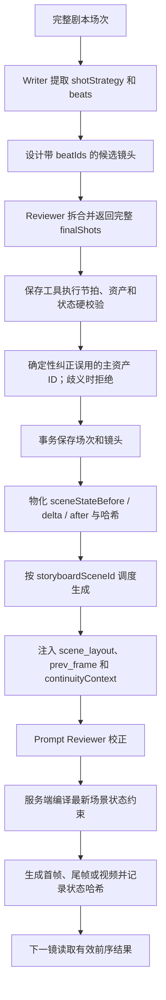

# 分镜镜头间连贯性优化

> 目标：从“怎么拆镜”开始，保证同一场次在分镜设计、首尾帧生成和视频生成中的剧情、角色、场景布局、物体状态与动作衔接一致。
>
> 当前状态：Writer、Reviewer、保存工具、数据库、生成上下文、场景状态时间线、媒体有效性、并发调度和前端编辑器均已接入。

场景布局与物体状态的底层模型另见 [场景状态时间线优化说明](./scene-state-timeline-optimization.md)。本文关注整条分镜连贯性链路，以及拆镜优化如何进入该链路。

## 一分钟理解

镜头间连贯性不是生成阶段才处理的问题。拆镜过碎会产生更多独立首帧，增加角色、构图和场景漂移；拆镜过粗又会让一个镜头在有限时长内承载过多对白、动作或场景变化，导致生成不可执行。

当前链路按六层处理：

| 层级 | 解决的问题 | 核心机制 |
|---|---|---|
| 分镜设计层 | 该不该切镜、节拍是否完整 | `shotStrategy + beats + beatIds` |
| 保存合同层 | Reviewer 修正是否完整落库 | 完整 `finalShots` + 保存前硬校验 + 整场事务 |
| 场景状态层 | 固定布局和可移动物体是否漂移 | 场景参考图 + `stateBefore/delta/stateAfter` |
| 生成上下文层 | 下一镜如何承接上一镜 | `continuityContext` + `scene_layout` + `prev_frame` |
| 生成与媒体层 | 是否误用旧状态或旧媒体 | 服务端状态编译、状态哈希和过期检测 |
| 调度层 | 同场镜头是否乱序 | 同场串行、跨场并行 |

核心原则：

1. 镜头服务叙事节拍，不服务每句台词或每个微动作。
2. 场景参考图决定固定布局，结构化状态决定可移动物体，前序提示词不能覆盖二者。
3. `CUT` 允许重新构图但继承场景状态；`SEAMLESS` 才允许在校验通过后直接复用上镜尾帧。
4. Reviewer 批准多少镜，保存工具就完整保存多少镜；不再静默删镜或部分成功。

## 解决的问题

旧链路主要存在以下风险：

- 同一叙事节拍被按推门、走路、坐下、翻找等微动作拆成多个镜头；
- 场次被强行套入互斥模板，普通叙事或混合场次拆镜失真；
- 反应镜、插入镜、文字特写和时长变化被当作固定配额；
- Reviewer 只给修改建议或删除标记，保存阶段可能丢失对白、时长、声音、资产和状态变化；
- LLM 不知道场景参考图的真实布局，却在每镜提示词中猜测门窗、家具和物体方位；
- 上一镜已经搬走或隐藏的物体在后续镜头重新出现；
- 全局串行限制了吞吐，完全并行又可能让同场镜头乱序；
- 状态变化后，旧首帧、尾帧或视频仍被继续当作有效参考。

## 第一层：节拍驱动的分镜设计

### 场次拆镜策略

每个场次先建立 `shotStrategy`：

```json
{
  "primaryType": "DIALOGUE",
  "tags": ["ACTION", "OBJECT_OPERATION"],
  "reason": "主要由信息交换推进，并包含一次关键物体操作"
}
```

`primaryType` 支持：

| 类型 | 用途 |
|---|---|
| `GENERAL_NARRATIVE` | 普通叙事和角色表演，是合法默认类型 |
| `DIALOGUE` | 由信息交换和说话权变化主导 |
| `ACTION` | 由动作目标、对抗转折和结果主导 |
| `CONTINUOUS_VISUAL` | 由连续机位、运动方向或空间阶段主导 |
| `MONTAGE` | 剧本明确存在时间压缩、空间跳跃或标题卡 |

混合场次用一个主类型和多个辅助标签表达，不再强行四选一。

### 叙事节拍

`beats` 表达剧情顺序中的目标、信息、冲突、情绪或状态变化：

```json
[
  {"id": "B1", "description": "角色进入并开始寻找文件", "sourceRefs": ["action:1"]},
  {"id": "B2", "description": "角色发现关键证据", "sourceRefs": ["dialogue:3"]}
]
```

节拍不是每句对白，也不是每个物理动作。多条短对白可以服务同一次信息交换；推门、进入、坐下和翻找也可以服务同一个搜索目标。

每个镜头使用 `beatIds` 记录覆盖关系：

- 一个镜头可以覆盖多个按剧情顺序连续的节拍；
- 同一节拍可以被相邻的合法正反打、反应镜或动作匹配镜头共同覆盖；
- 节拍数不等于镜头数；
- 所有节拍必须被覆盖，镜头不能包含节拍清单之外的新剧情；
- 全场镜头的节拍范围只能随剧情向前推进，不能在推进后返回更早节拍。

### 默认合并条件

相邻内容满足以下条件时优先合并：

- 同一连续时空；
- 服务同一人物目标或同一刺激源；
- 没有新信息、新冲突、新情绪拐点或必须独立读取的细节；
- 能在合理时长内用一个主导运镜完成；
- 合并后不会造成场景变体或物体状态冲突。

典型情况包括同一目标下的连续动作、同一物体的连续操作、同一刺激下的持续反应，以及同一连续运镜中的阶段变化。

### 合法拆分条件

只有存在明确叙事收益时拆分，例如：

- 时间跳跃、空间切换或平行剪辑；
- 新目标、新信息、新冲突或明确情绪拐点；
- 有信息量的正反打、过肩镜或对白覆盖；
- 剧本支持且理解剧情所需的反应镜、主观镜或插入镜；
- 必须独立读清的文字、屏幕或关键物证；
- 动作场中的动作匹配剪辑；
- 单镜时长内无法自然完成的极大景别、机位或空间阶段切换。

镜头数量和时长范围只用于触发复查，不是硬配额。单镜场次不强求节奏变化，动作场也不强制时长递减。

### 银幕方向

180 度规则的目标是保持动作轴、视线方向和人物关系可理解，不要求单人近景中的角色永远占据相同绝对坐标。角色换位或越轴必须在画面中建立，但当前镜头的人物左右关系不能反向写成场景固定布局。

## 第二层：Reviewer 与保存合同

### Reviewer 输入与输出

Writer 在每个场次保存前调用 `review_storyboard_content`，输入完整的：

- `shotStrategy` 和 `beats`；
- 完整剧本场次 `scriptScene`；
- 场次默认变体、固定布局和初始状态；
- 画风信息；
- 每个镜头的内容、节拍、时长、对白、声音、镜头语言、资产、状态变化和衔接模式。

Reviewer 可以合并过碎镜头，也可以拆开在给定时长内不可执行的超载镜头，但只能重新分配已有剧情内容，不能发明事件。

Reviewer 返回可直接保存的完整结果：

```text
approved
shotStrategy
beats
finalShots
issues
unresolvedErrors
reviewedShotCount
```

合并镜头时必须完整处理 `beatIds`、对白、时长、声音、角色、服装、道具、场景变体、`sceneStateDelta` 和镜头元数据。旧删除协议 `__MERGE_INTO_PREV__` 已停用。

### 保存前硬校验

`StoryboardShotPlanValidator` 和 `save_storyboard_scene_shots` 在任何数据库写入前校验：

- `reviewed=true`、`reviewApproved=true`；
- `unresolvedReviewErrors=[]`；
- `reviewedShotCount == finalShots.length`；
- 主策略合法，节拍 ID 唯一；
- 每镜 `beatIds` 非空、存在、连续且有序；
- 全场节拍完整覆盖，镜头节拍范围不倒退；
- 内容、画面期望、景别、时长、声音、运镜、机位和设备等必填字段完整；
- 每镜提供 `sceneStateDelta.changes` 和合法的 `CUT/SEAMLESS`；
- 场次必须有 `baseSceneAssetItemId`；
- `storyboardEpisodeId` 确实属于当前 `storyboardId`；
- 场景、角色、服装、道具和状态对象属于当前项目且资产类型正确。

### 主资产与子资产 ID 防混用

资产查询工具现在同时返回语义明确且兼容旧调用的字段：

| 层级 | 明确字段 | 兼容字段 | 用途 |
|---|---|---|---|
| 主资产 | `assets[].assetId` | `assets[].id` | 查询主资产及其变体 |
| 子资产 | `assets[].items[].assetItemId` | `items[].id` | 写入分镜资产与场景状态引用 |

`characterIds / costumeIds / propIds / baseSceneAssetItemId / sceneAssetItemId` 均使用 `AssetItem.id`。道具状态使用 `assetItem:<AssetItem.id>`，并且数字部分必须与同一道具在 `shots[].propIds` 中使用的子资产 ID 一致。Writer 在保存前自检，Reviewer 对初始状态和全部变化事件执行引用完整性检查。

保存层同样校验全场 `propIds` 并集：每个状态道具子资产至少被一个镜头绑定。这样即使错误 ID 恰好是数据库中另一个真实存在的 `AssetItem.id`，也不会以错误对象身份进入状态时间线。

保存工具还提供一层兼容性兜底。若 LLM 把道具主资产 ID 错写成 `assetItem:<Asset.id>`，系统只在以下情况之一能确定唯一子资产时统一修正 `initialSceneState` 和全部 `sceneStateDelta`：

- 当前场次所有 `propIds` 中，该主资产只对应一个子资产；
- 多个候选中只有一个子资产名称与状态对象名称精确一致；
- 该主资产本身只有一个可用子资产。

若同一主资产存在多个仍无法区分的变体，保存工具不会猜测，而是在任何写库前返回主资产 ID、候选子资产 ID 和修正要求。正常输入仍保持原来的两次批量资产查询；只有检测到错误的主资产 ID 时才增加批量主资产和子资产查询，不引入逐镜 N+1 查询。

校验通过后才创建场次和镜头。任一问题会让整场事务回滚，不再跳过单个镜头，因此 Reviewer 批准结果与最终落库结果保持一一对应。

持久化字段：

| 层级 | 字段 |
|---|---|
| 场次 | `shot_strategy`、`beats` |
| 镜头 | `beat_ids` |

对应迁移：`V1.0.7.0.8__storyboard_shot_plan_contract.sql`。

## 第三层：场景布局与状态时间线

同一场次共享物理空间，但不代表每个镜头构图完全相同。机位、景别、人物画面位置可以变化，固定结构和没有发生剧情变化的物体不能漂移。

场景一致性分三类数据：

| 数据 | 负责内容 |
|---|---|
| `baseSceneAssetItemId + layoutDefinition` | 默认场景变体、门窗、固定家具和空间结构 |
| `initialSceneState` | 场次开始时可移动物体的已知状态 |
| `sceneStateDelta` | 当前镜头真实发生的移动、显隐、增删或状态变化 |

服务端按 `sortOrder` 物化：

```text
sceneStateBefore + sceneStateDelta = sceneStateAfter
下一镜 sceneStateBefore = 上一镜 sceneStateAfter
```

场景变体用于“正常房间、搬家中、搬空后、改造完成”等可复用的整体阶段；单个箱子、椅子或道具移动使用 `MOVE/ADD/REMOVE/HIDE/SHOW/SET_STATE`，不为每次移动创建场景变体。

固定布局只记录剧本或资产已经明确的事实。参考图中未知的左右、前后、距离和朝向保持未知，禁止由 LLM 按生活常识补全。

### 固定家具组与真实容器

重复且不可移动的家具不逐张建成道具，而是使用 `layoutDefinition.anchors[].furnitureLayout` 建模：

| 字段 | 作用 |
|---|---|
| `arrangement / rows / columns` | 固定阵列的排列和已确认行列，例如教室课桌网格 |
| `aisleDescription` | 已确认的主过道、侧过道或空缺关系 |
| `empty` | 家具组是否为空置，避免模型凭空补出书本或收纳空间 |
| `prohibitedFeatures` | 场景参考图明确不存在、不可生成的结构 |

普通教室的课桌阵列应明确标记为空置，并在 `prohibitedFeatures` 中写入“抽屉、储物柜、独立金属柜体”。这不是全局禁词：真实柜体、车门储物格、搬家箱等仍可使用，但必须显式建模。

容器关系使用 `containerId`，并满足以下合同：

1. 目标必须是已经存在的 `layout:<锚点ID>` 或 `assetItem:<子资产ID>`，不能由 `location` 中的“桌内、抽屉里、收好”等文字推断。
2. 固定容器必须在布局锚点上标记 `canContainObjects=true`；道具容器必须在初始状态或当前镜头变化中显式标记同一字段。
3. 普通课桌、桌面、椅子、门窗和区域默认不是容器。`MOVE` 未提供 `containerId` 时表示移出此前容器。
4. 不可见对象只输出 `visible=false` 的不可见约束；其历史位置和容器不会进入生图提示词。因此“糖果收起”不会生成任何抽屉柜。

这套规则适用于所有剧本：它拒绝未声明的容器，同时保留真实纸箱、储物柜、车门储物格等资产的状态表达能力。

## 第四层：生成上下文与参考图

`get_storyboard_scene_items` 按镜头顺序返回：

- 场次 `shotStrategy / beats / baseSceneAssetItemId / layoutDefinition / initialSceneState`；
- 镜头 `beatIds / effectiveSceneAssetItemId`；
- `sceneStateBefore / sceneStateDelta / sceneStateAfter`；
- 状态哈希和首帧、尾帧、视频过期标记；
- 角色、服装、道具和场景参考图；
- 前序镜头 `continuityContext`。

首尾帧调用必须传入 `frameType`。只有“场次第一镜 + `frameType=first`”会返回 `role=style` 的画风参考图；尾帧和后续镜头不返回，也不得由生成入口插入。`suggestedReferenceImages` 的 `index`、提示词中的“图片 N”和传给 `generate_image.imageUrls` 的顺序是同一份不可重排合同。生成入口会在能力裁剪后校验最大图片编号，避免参考图被裁剪、插入或重排后静默错位。

`continuityContext` 包含前序剧情、首尾帧提示词、视频提示词、首尾帧 URL、前后状态哈希和 `canReusePrevLastFrame`。只有状态仍有效的前序媒体和提示词才会进入后续上下文。

参考信息的权威顺序：

1. `role=scene_layout` 场景参考图和固定布局；
2. 当前镜头有效场景变体；
3. `sceneStateBefore/delta/after`；
4. 当前镜头内容、节拍、机位和构图；
5. `prev_frame` 与前序提示词。

前序信息负责叙事动作、角色外貌、光线和色调承接，不负责解释固定空间或可移动物体位置。与场景参考图或状态时间线冲突时，必须丢弃前序位置描述。

`prev_frame` 优先使用前序有效尾帧，无有效尾帧时回落有效首帧。它用于外貌、光色和动作连续性；普通 `CUT` 不能把它当成本镜首帧直接复用。

## 第五层：生成、校正和媒体有效性

### 生成前硬约束

`SceneStatePromptCompiler` 在调用图片或视频模型前动态编译服务端场景状态约束：

- 首帧使用 `sceneStateBefore`；
- 尾帧使用 `sceneStateAfter`；
- 视频使用 `before -> delta -> after`。

数据库保存用户确认的业务提示词，不保存动态拼接后的硬约束。状态变化后重新生成时会使用最新时间线，避免旧位置描述污染新提示词。

### 场景与常服视觉锁定

场景图和常服图不是普通的风格参考。生成首尾帧时，参考图按以下优先级组织：

1. 场景固定布局；
2. 角色三视图；
3. 绑定常服；
4. 前序有效帧、角色素体、道具；
5. 画风参考图。

这样图片模型会先接收“房间结构、角色身份、穿什么”的硬事实，画风图只负责光影和质感，不会抢占人物或场景的视觉语义。`costumeIds=[]` 视为没有指定换装，自动回落到角色默认常服。

服务端还会从常服子资产的 `clothing` 读取文字描述，写入最终正向提示词，并在反向提示词加入“服装替换、未绑定服装、错误上下装、错误鞋履、错误配色、错误配饰”。除非镜头状态明确换装，人物的款式、配色、上下装、鞋履和配饰必须与绑定常服图一致。

固定结构的约束也会明确要求门、窗、墙体和固定家具的数量、可见性及相对位置与场景参考图一致，禁止新增、复制、移位或替换。镜头可以改机位和构图，但不能因换机位凭空出现另一扇门。

### Prompt Reviewer

首尾帧和视频提示词仍需经过 `prompt-reviewer`，检查剧情衔接、角色外貌、光线色调、动作承接、参考图引用和位置漂移。空间冲突按上述权威顺序修复，不把上一镜提示词当成位置事实。

### `CUT` 与 `SEAMLESS`

| 模式 | 状态继承 | 构图 | 上镜尾帧直接复用 |
|---|---|---|---|
| `CUT` | 继承 | 可重新构图、切机位和景别 | 不允许 |
| `SEAMLESS` | 继承 | 同机位、同构图、连续动作 | 满足哈希校验时允许 |

服务端只在以下条件同时满足时设置 `canReusePrevLastFrame=true`：

- 当前镜头为 `SEAMLESS`；
- 上一镜有有效尾帧；
- 当前 `stateBeforeHash` 等于上一镜 `stateAfterHash`；
- 上一镜尾帧生成时记录的状态哈希仍然有效。

### 媒体过期

| 媒体 | 当前状态哈希 | 生成时哈希 | 不一致时 |
|---|---|---|---|
| 首帧 | `stateBeforeHash` | `firstFrameStateHash` | `firstFrameStale=true` |
| 尾帧 | `stateAfterHash` | `lastFrameStateHash` | `lastFrameStale=true` |
| 视频 | `sceneStateHash` | `generatedVideoStateHash` | `videoStale=true` |

状态变化不会删除昂贵的已有媒体，但会阻止过期结果继续作为可靠参考。

## 第六层：同场串行、跨场并行

首尾帧和视频生成使用 `KeyedSequentialAgentToolAdapter`：

- 同一 `storyboardSceneId` 进入同一响应式串行队列；
- 不同场次使用不同队列并行执行；
- 缺少场次 ID 的旧调用回落到兼容全局串行队列；
- 使用 Reactor `concatMap`，没有 `.block()`、`Thread.sleep()` 或 `ThreadLocal`；
- 取消信号可以传递到正在执行的调用。

角色三视图、常服和其他衍生资产仍依赖角色初始图，继续按资产依赖顺序执行。这与“跨场次并行”属于不同调度边界。

## 完整链路



## 前端能力

分镜页可以打开“场景状态时间线”编辑器：

- 选择场次默认场景变体；
- 维护固定布局锚点，包含固定家具组的排列、行列、过道、空置和禁止生成结构；
- 维护初始物体状态，并仅为明确存在的真实柜体、箱子等标记“可容纳物体”；
- 为每个镜头设置变体覆盖、`CUT/SEAMLESS`、状态变化和已声明容器关系；
- 查看每镜 `before/after`；
- 查看首帧、尾帧和视频是否已过期。

保存时必须提交当前场次全部镜头，后端在一个事务中校验、更新并重建整场时间线。

## 关键实现文件

| 模块 | 文件 |
|---|---|
| 分镜 Writer | `ai--agent-video/src/main/resources/prompts/agents/episode-storyboard-writer.system.md` |
| 分镜 Reviewer | `ai--agent-video/src/main/resources/prompts/agents/storyboard-content-reviewer.system.md` |
| 分镜保存与资产校验 | `ai--agent-video/src/main/java/com/tonyhe/fusion/service/ai/tool/SaveStoryboardSceneShotsToolExecutor.java` |
| 分镜计划硬校验 | `ai--agent-video/src/main/java/com/tonyhe/fusion/service/storyboard/StoryboardShotPlanValidator.java` |
| 场景状态时间线 | `ai--agent-video/src/main/java/com/tonyhe/fusion/service/storyboard/SceneStateTimelineService.java` |
| 生成前状态编译 | `ai--agent-video/src/main/java/com/tonyhe/fusion/service/storyboard/SceneStatePromptCompiler.java` |
| 分镜生成上下文 | `ai--agent-video/src/main/java/com/tonyhe/fusion/service/ai/tool/GetStoryboardSceneItemsToolExecutor.java` |
| 响应式分键串行队列 | `ai--agent-video/src/main/java/com/tonyhe/fusion/service/ai/agentscope/KeyedSequentialAgentToolAdapter.java` |
| 首尾帧生成入口 | `ai--agent-video/src/main/java/com/tonyhe/fusion/service/ai/tool/GenerateImageToolExecutor.java` |
| 视频生成入口 | `ai--agent-video/src/main/java/com/tonyhe/fusion/service/ai/tool/GenerateVideoToolExecutor.java` |
| Prompt Reviewer | `ai--agent-video/src/main/resources/prompts/agents/prompt-reviewer.system.md` |
| 前端时间线编辑器 | `ai--agent-video-web/app/(dashboard)/projects/[id]/storyboards/_components/scene-state-timeline-dialog.tsx` |
| 数据库迁移 | `V1.0.7.0.7__storyboard_scene_state_timeline.sql`、`V1.0.7.0.8__storyboard_shot_plan_contract.sql` |

## 兼容与验收

- 旧分镜数据仍可读取，缺少场景状态时按空时间线和 `CUT` 运行；
- 旧调用缺少 `storyboardSceneId` 时自动回落全局串行队列；
- 新的拆镜合同不会自动回填旧数据中的 `shotStrategy / beats / beatIds`；
- 要完整验收拆镜、Reviewer、状态继承和媒体过期链路，需要重新生成至少一集分镜；
- 推荐选择同时包含对白、连续动作、道具移动和场景整体阶段变化的剧本场次验收。

本轮验证结果：

- 后端完整测试 `196` 项通过，`0` 失败；
- 前端 TypeScript 检查通过；
- 相关前端文件 ESLint 无错误、无警告；
- Next.js Webpack 生产构建通过；
- Flyway 数据库版本为 `1.0.7.0.8`；
- 验收完成后应确认并释放前端 `3000` 和后端 `18080` 端口。
