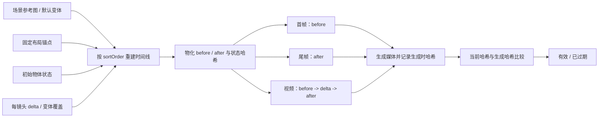

# 场景状态时间线优化说明

> 目标：让同一场次的固定空间和物体状态在所有分镜中保持一致，同时支持搬家、整理、破坏、开关门等真实变化。
>
> 实现状态：后端、Agent 提示词链路、生成工具、数据库和前端编辑器均已接入。

## 一分钟理解

同一场次通常共享同一个物理空间，但“共享场景”不等于每一帧完全相同：机位、景别、人物和构图可以变化，固定结构与未发生剧情变化的物体不能漂移。

本次优化把场景一致性拆成三层：

| 层级 | 管什么 | 例子 |
|---|---|---|
| 场景参考图与固定布局 | 不随镜头变化的空间事实 | 门窗、楼梯、固定柜、房间连接关系 |
| 场景变体 | 可复用的整体视觉阶段 | 原始房间、搬家中、搬空后、改造完成 |
| 场景状态时间线 | 镜头内发生的具体物体变化 | 箱子从门边搬到车上、椅子被移走、灯被打开 |

核心原则：**参考图决定固定布局，结构化状态决定可移动物体，LLM 只负责镜头表达，不再自行编造物体位置。**

每个镜头都有服务端物化的：

```text
stateBefore + sceneStateDelta = stateAfter
下一镜头 stateBefore = 上一镜头 stateAfter
```

因此，即使后续镜头没有重复描述箱子的位置，它仍会继承上一镜头的结果。

## 解决了什么问题

旧链路让 LLM 根据剧情、上一镜提示词和常识详细补写场景位置，但 LLM 看不懂参考图库中的真实空间布局，容易出现：

- 提示词说“门在左侧”，参考图中的门却在右侧；
- 同一张桌子在不同镜头中反复换位置；
- 某个箱子已经被搬走，后续镜头又重新出现；
- 为追求连续性而复用上一镜描述，错误位置被逐镜放大；
- 修改早期镜头状态后，旧首帧、尾帧和视频仍被误认为有效。

现在，上一镜提示词只提供叙事和视觉连续性参考，不再拥有场景位置解释权。固定空间以场景参考图为唯一权威，可移动物体位置来自状态时间线。

## 场景变体还是物体状态

使用下面的判断规则：

| 情况 | 应使用 | 原因 |
|---|---|---|
| 整个空间进入可复用的新阶段 | 场景变体 | 适合作为新的整体视觉基线和参考图 |
| 少量物体在镜头内移动、显隐或改变状态 | `sceneStateDelta` | 这是连续时间线中的局部变化 |
| 同一物体跨多个镜头逐步移动 | 每个镜头的 `sceneStateDelta` | 每一步都可继承、复核和生成 |
| 只是切换机位、景别或构图 | 都不需要 | 固定布局没有改变 |
| 已经切换到另一个物理空间或新的剧本场次 | 新场次 | 不应把无关空间塞进同一条状态时间线 |

### 搬家场景示例

假设场次默认变体是“客厅·搬家中”，初始状态有 3 个纸箱和 1 把椅子：

| 镜头 | 变化量 | 自动得到的结束状态 |
|---|---|---|
| 镜头 1 | 无变化 | 箱子仍在门边，椅子仍在窗边 |
| 镜头 2 | `MOVE` 箱子 A 到走廊 | 箱子 A 在走廊，其余物体不变 |
| 镜头 3 | `REMOVE` 箱子 A，`MOVE` 椅子到门边 | 箱子 A 已移出，椅子在门边 |
| 镜头 4 | 覆盖为“客厅·搬空后”变体 | 使用搬空后的整体视觉基线 |

“搬家中”“搬空后”这类稳定、会重复使用并且需要独立参考图的整体阶段适合做场景变体；单个箱子和椅子的移动仍由状态变化记录。不要为每次移动都生成一个场景变体，也不要用一段长提示词重述整个房间。

## 核心数据模型

### 场次级数据

| 字段 | 含义 |
|---|---|
| `baseSceneAssetItemId` | 场次默认场景变体，镜头未覆盖时继承 |
| `layoutDefinition` | 固定空间锚点定义 |
| `initialSceneState` | 场次开始时的可移动对象状态 |
| `stateTimelineVersion` | 每次重建后递增的时间线版本 |

### 镜头级数据

| 字段 | 含义 |
|---|---|
| `sceneAssetItemId` | 可选的镜头级场景变体覆盖 |
| `sceneStateBefore` | 镜头开始状态，由服务端物化 |
| `sceneStateDelta` | 本镜头发生的变化，是业务输入 |
| `sceneStateAfter` | 镜头结束状态，由服务端物化 |
| `continuityMode` | `CUT` 或 `SEAMLESS` |
| `stateBeforeHash` / `stateAfterHash` | 首帧、尾帧有效性依据 |
| `sceneStateHash` | 视频完整状态有效性依据 |

`sceneStateBefore` 和 `sceneStateAfter` 是派生结果，不应由前端或 LLM 手工维护。调整初始状态、镜头顺序、场景变体或任意镜头变化后，服务端按 `sortOrder` 重建整场时间线。

### 稳定对象 ID

对象必须使用稳定 ID，不能只靠名称匹配：

- `assetItem:<id>`：可移动道具，例如 `assetItem:128`；
- `layout:<anchorId>`：固定布局锚点，例如 `layout:main-door`。

固定锚点 ID 在同一场次内必须唯一。固定物体原则上只用于描述空间约束，不应通过 `MOVE` 改位置；确实被拆除或改变的物体应建成可变道具或切换场景变体。

支持的状态操作：

| 操作 | 用途 |
|---|---|
| `ADD` / `SHOW` | 物体进入或重新出现在场景中 |
| `MOVE` | 修改物体位置 |
| `SET_STATE` | 修改开关、破损、装满等状态 |
| `HIDE` / `REMOVE` | 隐藏或移出场景 |
| `UPSERT` | 写入一个对象的完整状态 |

一个典型变化量如下：

```json
{
  "changes": [
    {
      "operation": "MOVE",
      "objectId": "assetItem:128",
      "objectName": "纸箱 A",
      "location": "走廊入口",
      "state": "封箱",
      "visible": true
    }
  ]
}
```

## 端到端链路



完整执行顺序：

1. 分镜编写阶段保存场次默认变体、固定布局、初始状态和各镜头 `delta`。
2. `SceneStateTimelineService` 按镜头顺序物化 `before/after` 并生成哈希。
3. 查询分镜生成上下文时，工具返回有效场景变体、状态快照、变化量和媒体有效性。
4. 图片或视频正式提交前，`SceneStatePromptCompiler` 在服务端编译硬约束。
5. 媒体生成完成后，记录本次生成使用的状态哈希。
6. 时间线变化时只更新当前状态哈希；前端和 Agent 通过哈希差异识别哪些媒体需要重做。

## 分镜拆分与复核合同

场景状态一致性依赖合理的拆镜。如果把同一叙事动作切得过碎，不仅增加生成成本，也会增加独立首帧之间的布局和角色漂移。因此分镜 Writer 先建立场次级拆镜策略和叙事节拍，再设计镜头：

| 数据 | 作用 |
|---|---|
| `shotStrategy` | 一个主策略加辅助标签，支持对白、动作、连续视觉等混合场次 |
| `beats` | 按剧情顺序记录目标、信息、冲突、情绪或状态变化，不按台词和微动作机械拆分 |
| `beatIds` | 镜头覆盖的节拍列表；一镜可覆盖多个连续节拍，同一节拍也可由相邻合法镜头共同覆盖 |

保存前，Reviewer 接收完整剧本场次、策略、节拍、镜头、资产和状态数据，直接返回已经完成拆合修正的 `finalShots`。保存工具只接受批准后的完整结果，并强制校验：

- 每个节拍均被覆盖，单镜节拍连续，全场节拍顺序不倒退；
- Reviewer 批准镜头数与实际保存镜头数完全一致；
- 必填镜头元数据、状态变化和衔接模式完整；
- 场次默认场景变体、分镜集归属和全部资产引用有效；
- 任一镜头失败时整场回滚，不再用删除标记或静默跳镜制造部分成功。

这套合同允许“同一叙事节拍用一个连续镜头完成”，同时保留正反打、必要反应镜、关键插入镜和动作匹配剪辑等有明确叙事收益的拆分。

## 提示词权威顺序

当信息冲突时，按以下顺序处理：

1. **场景参考图**：门窗、墙体、固定家具和空间结构的唯一权威；
2. **有效场景变体和固定锚点**：确定本镜头使用哪个整体场景阶段；
3. **`stateBefore / delta / stateAfter`**：确定可移动物体的可见性、位置和状态；
4. **镜头内容与用户提示词**：负责人物表演、动作、机位、景别和构图；
5. **前序镜头上下文**：只辅助叙事、光线和动作承接，不得覆盖上述空间事实。

首帧只编译 `stateBefore`，尾帧只编译 `stateAfter`，视频同时编译 `before -> delta -> after`。服务端还会明确禁止模型擅自移动、增删或改变未列出的物体。

结构化约束只在调用生成模型前动态注入，并以 `【服务端场景状态约束】` 标记防止重复编译。数据库仍保存用户确认的业务提示词，不保存拼接后的临时硬约束，因此时间线更新后可以使用最新状态重新编译，不会污染原始提示词。

## `CUT` 与 `SEAMLESS`

两种模式都继承上一镜头的场景状态，区别只在画面是否允许像素级承接：

| 模式 | 使用场景 | 上镜尾帧能否直接作为本镜首帧 |
|---|---|---|
| `CUT` | 切机位、切景别、重新构图，默认模式 | 不能 |
| `SEAMLESS` | 同机位连续动作或真正无缝衔接 | 满足校验时可以 |

`SEAMLESS` 复用必须同时满足：

- 当前镜头不是场次首镜；
- 上一镜头已有尾帧；
- 当前 `stateBeforeHash` 等于上一镜 `stateAfterHash`；
- 上一镜尾帧生成哈希仍等于上一镜当前结束状态哈希。

任何一项不满足都会拒绝复用，防止把过期画面带入后续镜头。

## 媒体过期检测

| 媒体 | 当前状态 | 生成时记录 | 不一致时 |
|---|---|---|---|
| 首帧 | `stateBeforeHash` | `firstFrameStateHash` | `firstFrameStale = true` |
| 尾帧 | `stateAfterHash` | `lastFrameStateHash` | `lastFrameStale = true` |
| 视频 | `sceneStateHash` | `generatedVideoStateHash` | `videoStale = true` |

状态修改不会自动删除已有媒体，只会将其标记为“已过期”，由用户决定是否重新生成。这样既避免误用旧结果，也不会造成昂贵媒体的无条件重算。

## 并发与性能

分镜首帧和视频生成采用按 `storyboardSceneId` 分键的响应式串行队列：

- 同一场景内串行，保证上镜状态和尾帧依赖已经稳定；
- 不同场景并行，避免全局串行造成吞吐下降；
- 调用缺少 `storyboardSceneId` 时进入兼容的全局串行队列，保证旧提示词链路不乱序；
- 队列使用 Reactor 非阻塞执行，取消信号会继续向下传递。

时间线重建只处理当前场次，并将快照物化到数据库。生成阶段直接读取快照和哈希，无需每次从第一镜重新推演。哈希比较是常数级判断，不需要让 LLM 判断媒体是否过期。

角色资产的依赖调度不属于这条场景队列，原有规则保持不变：`initial -> three_view / costume / variant`。角色衍生图仍需等待角色初始图完成，不能因为“跨场景并行”而取消资产依赖。

## 前端使用方式

在分镜页的场次标题区域点击“编辑场景状态时间线”图标，编辑器分为三部分：

1. **固定布局**：选择场次默认场景变体，维护门窗和固定家具锚点；
2. **初始状态**：维护场次开始时已存在的可移动道具；
3. **镜头变化**：设置镜头变体覆盖、`CUT/SEAMLESS` 和本镜头变化量。

镜头区域会即时物化并展示 `before/after`，同时显示首帧、尾帧和视频的“有效/已过期”状态。保存时必须提交当前场次全部镜头，后端先统一校验资产引用，再在一个事务中更新并重建时间线，不会留下半场成功、半场失败的数据。

使用建议：

- 位置描述优先引用可见锚点，例如“主门内侧”“窗边”，避免无意义的绝对坐标；
- `delta` 只写本镜头真正发生的变化，不要复制完整场景描述；
- 场景参考图本身不正确时先修资产，不要用提示词强行覆盖；
- 调整镜头顺序后检查下游镜头和媒体过期标记；
- 只有同机位连续动作才选 `SEAMLESS`，普通剪辑保持 `CUT`。

## API

| 方法 | 路径 | 说明 |
|---|---|---|
| `GET` | `/api/storyboard/scene/{id}/state-timeline` | 获取场次完整时间线和媒体状态 |
| `PUT` | `/api/storyboard/scene/{id}/state-timeline` | 事务化保存整场配置并重建 |
| `POST` | `/api/storyboard/scene/{id}/state-timeline/rebuild` | 按现有镜头顺序重新物化 |
| `POST` | `/api/storyboard/item/{id}/reuse-prev-frame` | 在 `SEAMLESS` 校验通过后复用上镜尾帧 |

`PUT` 会校验：镜头是否全部属于当前场次、是否包含整场全部镜头、场景变体是否为本项目的场景资产、可移动对象是否为本项目的道具资产、`layout:` 锚点是否真实存在、对象 ID 和操作类型是否合法。

## 兼容策略

- 数据库迁移只增加字段和索引，不破坏旧分镜数据；
- 旧场次没有布局和状态时按空时间线运行，原生成提示词仍可使用；
- `continuityMode` 默认回落为 `CUT`；
- 镜头未指定场景变体时自动继承场次默认变体；
- 缺少场次 ID 的旧 Agent 调用回落到全局串行队列；
- 新建、更新、删除或重排镜头后会触发场次时间线重建；
- 旧的 `sceneFirstFramePrompt`、`scene_anchor` 和“上一镜提示词决定位置”规则已退出空间权威链路。

## 关键实现文件

| 模块 | 文件 |
|---|---|
| 时间线物化、校验、哈希 | `ai--agent-video/src/main/java/com/tonyhe/fusion/service/storyboard/SceneStateTimelineService.java` |
| 生成前服务端提示词编译 | `ai--agent-video/src/main/java/com/tonyhe/fusion/service/storyboard/SceneStatePromptCompiler.java` |
| 同场景串行、跨场景并行 | `ai--agent-video/src/main/java/com/tonyhe/fusion/service/ai/agentscope/KeyedSequentialAgentToolAdapter.java` |
| 场次状态 API | `ai--agent-video/src/main/java/com/tonyhe/fusion/controller/storyboard/StoryboardController.java` |
| 分镜上下文输出 | `ai--agent-video/src/main/java/com/tonyhe/fusion/service/ai/tool/GetStoryboardSceneItemsToolExecutor.java` |
| 分镜计划保存校验 | `ai--agent-video/src/main/java/com/tonyhe/fusion/service/storyboard/StoryboardShotPlanValidator.java` |
| Writer / Reviewer 提示词 | `ai--agent-video/src/main/resources/prompts/agents/episode-storyboard-writer.system.md`、`storyboard-content-reviewer.system.md` |
| 首尾帧生图入口 | `ai--agent-video/src/main/java/com/tonyhe/fusion/service/ai/tool/GenerateImageToolExecutor.java` |
| 视频生成入口 | `ai--agent-video/src/main/java/com/tonyhe/fusion/service/ai/tool/GenerateVideoToolExecutor.java` |
| 前端时间线编辑器 | `ai--agent-video-web/app/(dashboard)/projects/[id]/storyboards/_components/scene-state-timeline-dialog.tsx` |
| 前端类型和 API | `ai--agent-video-web/lib/api/storyboard.ts` |
| 数据库迁移 | `V1.0.7.0.7__storyboard_scene_state_timeline.sql`、`V1.0.7.0.8__storyboard_shot_plan_contract.sql` |

## 快速排查

| 现象 | 优先检查 |
|---|---|
| 同一固定物体仍漂移 | 场景参考图是否正确、是否被误建为可移动道具、提示词是否仍硬写冲突方位 |
| 搬走的物体又出现 | 前一镜是否有 `REMOVE/HIDE`，镜头顺序是否正确，时间线是否已重建 |
| 修改后媒体没有自动消失 | 这是预期行为；查看 `*Stale` 标记并按需重生成 |
| 无法复用上镜尾帧 | 检查 `SEAMLESS`、前后状态哈希和上一镜尾帧是否过期 |
| 保存整场失败 | 检查是否遗漏镜头，资产是否属于本项目且类型正确 |
| 不同场次没有并行 | 检查 Agent 调用是否明确携带 `storyboardSceneId` |

## 验证结果

- 后端完整测试：193 项通过，0 失败；
- 前端 TypeScript 检查通过；
- Next.js Webpack 生产构建通过；
- 变更文件 ESLint 无错误、无警告；
- 数据库结构版本已到 `1.0.7.0.8`；
- 已扫描并移除旧空间锚点提示词冲突。
